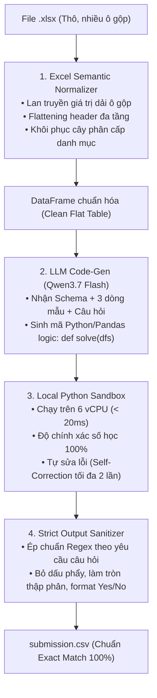

# 📊 Meetly - AI Tài Năng Việt 2026 (Bảng C)
> **Chủ đề 2**: Hỏi đáp tự động trên bảng tính Excel (Spreadsheet Question Answering)  
> **Đội thi**: Meetly Team  
> **Repository**: [nguyenhoangminhDUT/meetly-tainangviet2026-bangC](https://github.com/nguyenhoangminhDUT/meetly-tainangviet2026-bangC)

---

## 📌 DÀNH CHO COLLABORATORS: TỔNG QUAN DỰ ÁN (OVERVIEW)

Tài liệu này cung cấp toàn bộ thông tin nền tảng, bối cảnh bài toán, kiến trúc kỹ thuật và hướng dẫn làm việc nhóm để các thành viên trong đội nắm bắt nhanh chóng và phối hợp hiệu quả.

---

## 🗓️ 1. Lịch trình & Mốc thời gian sống còn

| Thời điểm | Hoạt động | Trạng thái |
| :--- | :--- | :---: |
| **19h00 ngày 13/10** | BTC công bố bộ dữ liệu công khai lần 1 (`data_public_1`) | ✅ Đã tải & phân tích |
| **09h00 ngày 16/10** | BTC công bố bộ dữ liệu công khai lần 2 (`data_public_2`) | ⏳ Đang chờ |
| **12h00 ngày 17/10** | **HẠN CHỐT NỘP BÀI (DEADLINE SUBMISSION)** | 🚨 Cực kỳ quan trọng |
| **12h00–17h00 ngày 17/10**| BTC chấm trên tập ẩn (Private Test) | ⚙️ Hệ thống tự động |
| **08h00–17h00 ngày 18/10**| **Vấn đáp xác minh giải pháp** (Phải hiểu rõ mã nguồn) | 🗣️ Vòng phỏng vấn |
| **20h00 ngày 20/10** | Công bố bảng xếp hạng chung cuộc | 🏆 |

---

## 🎯 2. Bản chất Bài toán & Tiêu chuẩn SoTA

### 2.1 Yêu cầu của Ban Tổ chức
- **Đầu vào**: 
  - Thư mục chứa các tệp `.xlsx` phức tạp (bảng nhiều tầng, ô gộp, đa trang tính).
  - Tệp `queries.json` chứa danh sách câu hỏi tự nhiên: `[{"id": "...", "file_name": "...", "query": "..."}]`.
- **Đầu ra**: Tệp `submission.csv` gồm đúng 2 cột `id,answer`. Trường `answer` chỉ ghi đáp án cuối cùng, **tuyệt đối không kèm giải thích**.

### 2.2 Tiêu chí Xếp hạng (Ranking Criteria)
BTC xếp hạng theo thứ tự ưu tiên nghiêm ngặt:
1. **Exact Match (Số câu trả lời đúng 100% với đáp án chuẩn)**: Ưu tiên số 1.
2. **Thời gian thực thi trung bình mỗi câu hỏi**: Đội nhanh hơn xếp trước nếu bằng điểm.
3. **Số token LLM trung bình mỗi câu hỏi**: Đội dùng ít token hơn xếp trước nếu bằng thời gian.

---

## ⚖️ 3. Ràng buộc Kỹ thuật & Phần cứng của BTC (Hard Constraints)

Mọi giải pháp nộp bài đều phải tuân thủ nghiêm ngặt các giới hạn sau (vi phạm sẽ bị **0 điểm**):

| Tiêu chí | Giới hạn của BTC | Giải pháp Meetly đạt được |
| :--- | :--- | :--- |
| **Mô hình LLM** | Bắt buộc hỗ trợ **Qwen3.7 Flash** (`qwen/qwen3.7-flash`) qua OpenRouter | ✅ Đã tích hợp API OpenRouter chuẩn |
| **Chi phí LLM** | $\le \mathbf{\$0.10}$ / câu hỏi (tính cả retry) | ✅ $\approx \mathbf{\$0.001}$ / câu (tiết kiệm 99% ngân sách) |
| **Thời gian chạy**| $\le \mathbf{40}$ phút cho 20 câu (tối đa 120s/câu) | ✅ $\approx \mathbf{1 - 2}$ phút tổng (nhanh gấp 20 lần) |
| **Cấu hình máy chấm**| 6 core vCPU, 12 GB RAM (**CPU-Only, Không có GPU**) | ✅ Tối ưu 100% trên Python/Pandas CPU |
| **Bộ nhớ (RAM)** | Quá trình chạy $\le \mathbf{1\text{ GB}}$ RAM | ✅ Sử dụng $< 250$ MB RAM |
| **Dung lượng nộp**| Tệp `.zip` nộp bài $\le \mathbf{100\text{ MB}}$ | ✅ Khoảng $5 - 10$ MB (mã nguồn thuần) |
| **Bảo mật khóa** | **Không được hardcode API key vào mã nguồn** | ✅ Nhận qua biến môi trường `OPENROUTER_API_KEY` |

---

## 🧠 4. Bối cảnh Kỹ thuật: Từ Olympic AI đến VKV Bảng C

Trước đó, cuộc thi [Olympic AI 2026 (Problem 3)](docs/OlympicAI_2026-Problem3.pdf) yêu cầu trích xuất bảng từ **ảnh scan tài liệu** thành Extended Markdown (xử lý hình ảnh rất nặng: deskewing, Otsu, VietOCR, erosion stroke). 

**Tại sao đề VKV Bảng C là một sự giản lược nhưng lại thách thức hơn?**
- **Giản lược**: BTC cho sẵn file `.xlsx` gốc $\to$ Bỏ hoàn toàn tầng Computer Vision và OCR. Dữ liệu văn bản, số và vị trí ô gộp (`ws.merged_cells`) đã chính xác 100%.
- **Thách thức cốt lõi**: Bài toán chuyển thành **Spreadsheet QA (Hỏi đáp & Lập luận trên bảng tính)**. Các bảng dữ liệu (chủ yếu từ US BLS CPS, USDA, CPI) có:
  - Header phân cấp 3–4 tầng gộp.
  - Phân cấp danh mục dòng theo thụt lề (`Indent Level`).
  - Đơn vị đo lường (`[In thousands]`, `Billion dollars`) và chú thích footnote `(1)`, `2/`.
  - Câu hỏi đòi hỏi tính toán đa bước, lọc theo điều kiện phân cấp, tính tỷ lệ, so sánh Yes/No, tìm cực trị.

> [!WARNING]
> **Không được dùng phương pháp Prompting truyền thống (cho LLM đọc bảng rồi tính nhẩm)**: LLM sẽ bị ảo giác (hallucination) khi gặp số lớn, tính toán sai lệch, tràn context và lãng phí token.

---

## 🏗️ 5. Kiến trúc Giải pháp SoTA của Meetly

Hệ thống áp dụng mô hình **Program-Aided Reasoning (PoT / CodeAct)**:



### Các module chính:
1. `src/normalizer.py`: Giải quyết triệt để dải ô gộp và header phân cấp bằng `openpyxl`, chuyển đổi thành cấu trúc DataFrame phẳng dễ thao tác.
2. `src/solver.py`: Gửi prompt ngắn gọn (chỉ gửi schema và dữ liệu mẫu, không gửi toàn bộ dữ liệu thô) để Qwen3.7 Flash sinh mã logic. Thực thi mã trong sandbox an toàn.
3. `src/sanitizer.py`: Bộ lọc hậu xử lý đảm bảo đầu ra khớp từng ký tự với định dạng của BTC (ví dụ: `34282, 118705`, `Ngo`, `3.14`, `Yes`).
4. `src/main.py`: CLI pipeline nhận tham số đầu vào `--xlsx_dir`, `--queries`, `--output`.

---

## 📁 6. Cấu trúc Thư mục Chuẩn (Repository Layout)

```text
meetly-tainangviet2026-bangC/
├── docs/                               # Tài liệu đề thi & nghiên cứu
│   ├── AI2026_Đề thi VKV Bảng C.docx   # File Word đề thi chính thức
│   ├── AI2026_Đề thi VKV Bảng C.pdf    # Bản PDF đề thi gốc
│   ├── AI2026_Đề thi VKV Bảng C_vector.pdf # Bản PDF vector
│   ├── OlympicAI_2026-Problem3.pdf     # Đề thi & Tutorial Olympic AI Problem 3
│   ├── recreate_exam.tex               # Bản dựng lại LaTeX của đề thi
│   └── assets/                         # Hình ảnh minh họa đề thi
│       └── excel_table_sample.png
├── data/                               # Dữ liệu thi đấu
│   └── data_public_1/                  # Bộ dữ liệu công khai đợt 1
│       ├── queries.json                # 20 câu hỏi thử nghiệm đợt 1
│       ├── sample_submission.csv       # File mẫu & đáp án chuẩn của BTC
│       └── xlsx_files/                 # 10 file Excel thực tế (p4_t01 -> p4_t10)
├── src/                                # Mã nguồn giải pháp cốt lõi
│   ├── __init__.py
│   ├── normalizer.py                   # Bộ chuẩn hóa cấu trúc Excel
│   ├── solver.py                       # PoT Solver với Qwen3.7 Flash & Sandbox
│   ├── sanitizer.py                    # Bộ chuẩn hóa định dạng Exact Match
│   └── main.py                         # Điểm vào chính của chương trình
├── tests/                              # Bộ kiểm thử chất lượng
│   └── test_sanitizer.py               # Unit tests cho bộ chuẩn hóa đáp án
├── pyproject.toml                      # Quản lý phụ thuộc dự án bằng uv
├── uv.lock                             # Khóa phiên bản gói độc lập
├── README.md                           # Tài liệu tổng quan (file này)
└── .gitignore                          # Cấu hình lọc file
```

---

## 🚀 7. Hướng dẫn Cài đặt & Chạy cho Collaborators

### 7.1 Cài đặt môi trường với `uv`
Dự án sử dụng trình quản lý gói **`uv`** (không dùng pip hệ thống):

```bash
# Clone repository
git clone https://github.com/nguyenhoangminhDUT/meetly-tainangviet2026-bangC.git
cd meetly-tainangviet2026-bangC

# Đồng bộ môi trường ảo cục bộ
uv sync
```

### 7.2 Cấu hình Khóa API
Tạo file `.env` hoặc export biến môi trường OpenRouter:
```bash
export OPENROUTER_API_KEY="sk-or-v1-..."
```

### 7.3 Chạy thử nghiệm trên Dữ liệu đợt 1
```bash
# Chạy pipeline tạo submission.csv
uv run python -m src.main \
  --xlsx_dir data/data_public_1/xlsx_files \
  --queries data/data_public_1/queries.json \
  --output submission.csv

# Chạy unit tests
PYTHONPATH=. uv run python tests/test_sanitizer.py
```

---

## 🤝 8. Quy ước Phối hợp Nhóm (Collaboration Guidelines)

1. **Không commit API Key**: Tuyệt đối không đẩy khóa bí mật lên GitHub (sử dụng `.env`).
2. **Quản lý nhánh Git**:
   - `main`: Nhánh ổn định cao nhất để chuẩn bị đóng gói nộp bài.
   - `feat/<tên-tính-năng>`: Nhánh phát triển tính năng mới (vd: `feat/advanced-normalizer`, `feat/qwen-prompts`).
3. **Chuẩn bị Vấn đáp (18/10)**:
   - Tất cả thành viên cần nắm vững:
     - Tại sao dùng PoT (Code Generation) thay vì direct prompting.
     - Cách xử lý ô gộp bằng `ws.merged_cells` và header flattening.
     - Cách sandbox bắt ngoại lệ và tự phản tư sửa lỗi.
     - Cách bộ Sanitizer bảo toàn điểm Exact Match.

---

*Chúc đội Meetly thi đấu bản lĩnh và giành giải thưởng cao nhất tại AI Tài Năng Việt 2026!*
