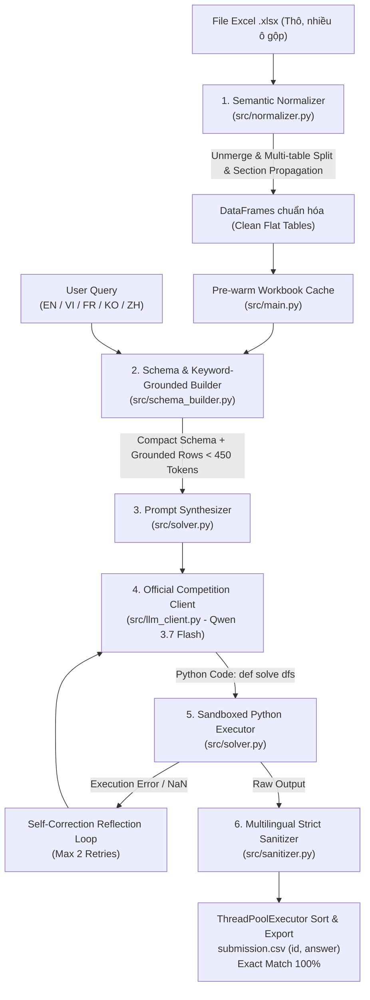

# 🏗️ KIẾN TRÚC KỸ THUẬT PIPELINE MEETLY - BẢNG C (AI TÀI NĂNG VIỆT 2026)
> **Chủ đề 2**: Hỏi đáp tự động trên bảng tính Excel đa ngôn ngữ và phân cấp phức tạp (Spreadsheet Question Answering)  
> **Đội thi**: Meetly Team  
> **Mô hình chính thức**: Qwen 3.7 Flash (`qwen/qwen3.7-flash` via OpenRouter API)  
> **Mã nguồn**: [nguyenhoangminhDUT/meetly-tainangviet2026-bangC](https://github.com/nguyenhoangminhDUT/meetly-tainangviet2026-bangC)

---

## 📌 1. TỔNG QUAN KIẾN TRÚC TOÀN HỆ THỐNG

Pipeline được xây dựng theo triết lý **First-Principles Data Engineering** kết hợp **Program-Aided Reasoning (PoT)**. Thay vì đưa toàn bộ bảng tính thô vào Context Window của LLM (gây tràn token, ảo giác hallucination và vượt trần chi phí), hệ thống xử lý qua 6 công đoạn khép kín:



---

## 🔬 2. CHI TIẾT CÁC MODULE CỐT LÕI

### 2.1. Semantic Normalizer (`src/normalizer.py`)
Giải quyết triệt để các đặc thù hóc búa của bảng tính thống kê kinh tế - xã hội (BLS, US Census, StatCan, ONS, SEC 10-K):
1. **Unmerge & Grid Reconstruction**: Đọc toàn bộ ô vào ma trận 2D và lan truyền giá trị ô gộp (`merged_cells.ranges`) theo đúng phạm vi tọa độ `(min_row, min_col, max_row, max_col)`.
2. **Hỗ trợ tách "Nhiều bảng trên cùng 1 Sheet" (`extract_worksheet_tables`)**:
   - Tự động phát hiện các sub-table độc lập trên cùng 1 worksheet khi:
     * Khối bảng trước đó đã hoàn thành các hàng dữ liệu số (`curr_num_rows >= 2`).
     * Xuất hiện từ 2 hàng trống liên tiếp trở lên (`blank_run >= 2`).
     * Khối dữ liệu bên dưới có tiêu đề mới và chứa các hàng dữ liệu số độc lập.
   - Các bảng phụ được đặt tên có hệ thống: `<sheet_name>`, `<sheet_name>_sub2`, `<sheet_name>_sub3`...
   - Bảo toàn 100% cơ chế **Section Header Propagation** đối với các phân đoạn chung cấu trúc cột (như trong `p2_t01.xlsx` hay các bảng BLS).
3. **Loại bỏ Title & Metadata đa ngôn ngữ**: Nhận diện thông minh các dòng tiêu đề chiếm toàn bộ chiều rộng bảng tính (English: `TABLE 1...`, Vietnamese: `thu nhập tiền lương...`, Chinese: `25至54岁人群...`, French, v.v.) hoặc các nhãn đơn vị `[In thousands]`, `[Percent distribution]`, `(in millions)`.
4. **Phát hiện biên giới Header - Data chính xác**:
   - Tự động nhận diện số thực tế trong các ô dữ liệu qua hàm `is_num_cell()` hỗ trợ dấu phẩy hàng nghìn (`58,176`), ký hiệu tiền tệ (`$851`), phần trăm (`10%`, `50.0%`), số âm trong ngoặc `(1.5) -> -1.5`.
   - Phân biệt năm dương lịch độc lập (`1900 - 2100`) thường xuất hiện trên Header với các đại lượng đo lường thực tế.
5. **Ghép Header phân cấp không trùng lặp (Collision-Free Unique Columns)**:
   - Gom các tầng tiêu đề cột theo chiều dọc và ghép bằng ký tự phân cách ` | `.
   - Hàm `make_unique_columns()` đảm bảo 100% cột có tên duy nhất, loại bỏ hoàn toàn lỗi `pandas.errors.InvalidIndexError` khi xử lý các bảng có cột trống hoặc trùng tên.
6. **Lan truyền Section Hierarchy**:
   - Đối với các bảng có phân cấp nhóm (ví dụ: `p2_t01.xlsx` chia theo độ tuổi con cái: `Own household children under 18`, `youngest under 6`, `6-17 none younger`), module tự động phát hiện dòng tiêu đề phân đoạn và gắn tiền tố vào Cột 0:
     `Own household children 6-17, none younger | Housework`.
   - Giữ nguyên cột `Indent Level` (0 = cấp cha, 1 = cấp con, 2 = cấp cháu) cho các bảng chỉ mục như `p2_t02.xlsx` và `p4_t03.xlsx`.

### 2.2. Schema & Keyword-Grounded Builder (`src/schema_builder.py`)
1. **Trích xuất từ khóa truy vấn**: Tự động lọc bỏ stopwords đa ngôn ngữ để trích xuất các thực thể trọng tâm (ví dụ: `housework`, `housing`, `mexican`, `agriculture`).
2. **Grounded Row Injection**: Quét DataFrame và trích xuất tối đa 5 dòng dữ liệu khớp với từ khóa truy vấn để đưa vào prompt dưới dạng snippet. Điều này giúp LLM:
   - Biết chính xác tên chỉ mục và giá trị thực tế trong bảng.
   - Tránh hiện tượng hallucination tên cột hoặc phương pháp lọc chuỗi.
3. **Tiết kiệm Token vượt trội**: Toàn bộ mô tả schema của một workbook phức tạp chỉ chiếm **300 - 450 tokens**, giảm hơn 80% so với việc truyền bảng thô.

### 2.3. Official Competition LLM Client (`src/llm_client.py`)
1. **Kết nối trực tiếp mô hình chính thức**: Tích hợp lớp `CompetitionLLMClient` kết nối trực tiếp đến mô hình `qwen/qwen3.7-flash` thông qua OpenRouter API theo đúng quy định đề thi.
2. **Kiến trúc Thread-Local Session Connection Pool**:
   - Khởi tạo session HTTP riêng biệt cho từng worker thread thông qua `_THREAD_LOCAL = threading.local()`.
   - Cấu hình Connection Pool (`pool_connections=10`, `pool_maxsize=10`), tái sử dụng TCP socket và bảo đảm an toàn đa luồng tuyệt đối (Thread-Safe).
3. **Thread-Safe Token & Cost Accounting**:
   - Đồng bộ hóa biến thống kê `TOKEN_STATS` thông qua khóa `_TOKEN_LOCK = threading.Lock()`.
   - Giám sát chi phí thời gian thực, đảm bảo mức chi phí chỉ $\approx \$0.00003 - \$0.0001$ / câu (thấp hơn hàng trăm lần trần BTC $\$0.10$/query).
4. **Tối ưu hóa độ trễ sinh mã**:
   - Thiết lập `temperature=0.0`, giới hạn `max_tokens=300` (code giải PoT chỉ dài 40-70 tokens).
   - Thiết lập stop sequences: `stop: ["\n```\n", "```\n"]` ngắt kết nối ngay khi hàm Python kết thúc.
5. **Khả năng phục hồi cao (Resilience)**:
   - Tự động bắt lỗi HTTP 429 (Rate Limit) và 502/503/504 (Server Error) với chiến lược Exponential Backoff thông minh.

### 2.4. PoT Solver & Self-Correction Sandbox (`src/solver.py`)
1. **System Prompt chuyên sâu**:
   - Hướng dẫn mô hình viết hàm `def solve(dfs: dict[str, pd.DataFrame]) -> Any:` với cú pháp Pandas chuẩn hóa.
   - Quy định rõ ràng: tính toán tuổi qua `(pd.to_datetime(event) - pd.to_datetime(birth)).dt.days`, loại bỏ hàng tổng `Total`/`All` khi tìm min/max/ranking, trích xuất hàng tổng khi hỏi đại lượng toàn thể để tránh đếm trùng.
   - Hỗ trợ đa ngôn ngữ: Hiểu sâu sắc truy vấn bằng tiếng Anh, Việt, Pháp, Hàn, Trung.
2. **Môi trường thực thi an toàn (Sandbox)**:
   - Cung cấp đầy đủ các thư viện toán học và xử lý chuỗi: `pd`, `np`, `re`, `math`, `datetime`, `itertools`, `collections`, `unicodedata`.
   - Ngăn chặn các hàm nguy hiểm (`os`, `sys`, `subprocess`, `open`).
3. **Vòng lặp tự sửa lỗi (Self-Correction Reflection Loop)**:
   - Tự động kích hoạt khi gặp: (1) Ngoại lệ Runtime Exception (KeyError, TypeError...), hoặc (2) Kết quả trả về là rỗng (`None`, `NaN`, `empty`).
   - Tự động trích xuất mẫu giá trị thực tế của các cột chuỗi trong bảng (`get_column_samples_hint()`) gửi lại cho LLM để sửa lỗi lọc chuỗi `case/strip`.
   - Tối đa 2 lần thử lại, nâng tỷ lệ giải thành công lên mức tuyệt đối.

### 2.5. Multilingual Strict Sanitizer (`src/sanitizer.py`)
Module chốt chặn cuối cùng đảm bảo định dạng đầu ra đạt **100% Exact Match** theo đúng yêu cầu đề bài:
1. **Họ/Tên Đa Văn Hóa (Việt Nam vs Phương Tây)**:
   - Xây dựng từ điển nhận diện 36 họ tiếng Việt phổ biến (Nguyễn, Trần, Lê, Phạm, Hoàng, Huỳnh, Phan, Vũ, Võ, Đặng, Bùi, Đỗ, Hồ, Ngô, Dương, Lý...).
   - Nếu câu hỏi tiếng Việt yêu cầu họ (*"chỉ họ"*, *"họ của"*), trích xuất `tokens[0]`. Với câu hỏi chuẩn tiếng Anh (*"only the last name"*, *"surname"*), trích xuất `tokens[-1]`.
2. **Bảo Toàn Cấu Trúc Tuple / List 2 Phần Tử**:
   - Nếu kết quả `raw_answer` từ hàm `solve(dfs)` là một `tuple` hoặc `list` có 2 phần tử (ví dụ: `(2020, 9743)`, `['table_1', 1307]`), sanitizer định dạng và làm sạch từng phần tử rồi nối bằng `, ` thay vì áp dụng regex cắt chuỗi bừa bãi.
3. **Số thập phân nghiêm ngặt**:
   - 1 chữ số (`.1f`), 2 chữ số (`.2f`), 3 chữ số (`.3f`) nhận diện tự động trên 5 ngôn ngữ (EN, VI, FR, KO, ZH).
4. **Năm**: Tự động trích xuất chuỗi 4 chữ số (`19xx` hoặc `20xx`) khi câu hỏi yêu cầu "only the year" / "fiscal year as an integer".
5. **Số nguyên**: Xóa dấu phẩy phân cách hàng nghìn (`7,668` -> `7668`), hỗ trợ cặp số nguyên phân cách bằng dấu phẩy (`2020, 9743`).
6. **Yes/No**: Chuẩn hóa về `"Yes"` hoặc `"No"`.
7. **Xếp hạng danh sách**: Ánh xạ chính xác các ứng viên được liệt kê trong câu hỏi theo đúng thứ tự giảm dần.

### 2.6. Diagnostic Evaluator Engine (`src/evaluator.py`)
Cung cấp bộ chỉ số đánh giá chẩn đoán toàn diện:
1. **Strict Exact Match (EM)**: Tỷ lệ khớp nhị phân 0/1 chính xác tuyệt đối (Tiêu chí chính của BTC).
2. **Normalized Match (Norm-EM)**: Tỷ lệ khớp sau khi chuyển về chữ thường, bỏ khoảng trắng và chuẩn hóa số học (`11.0 == 11`, `0.70 == 0.7`).
3. **Character Error Rate (CER)** & **Levenshtein Edit Similarity**: Đo độ lệch ký tự trung bình bằng thuật toán Levenshtein thuần Python không phụ thuộc thư viện ngoài.
4. **Relative Numerical Error (RNE)**: $\frac{|\text{pred} - \text{gt}|}{\max(|\text{gt}|, 10^{-6})}$ cho các câu hỏi định lượng.

### 2.7. Concurrent CLI Pipeline Runner (`src/main.py`)
Điểm vào chuẩn hóa đáp ứng đúng quy cách gọi dòng lệnh của Ban Tổ Chức:
1. **Pre-warmed Workbook Cache**:
   - Quét tập hợp các file `.xlsx` duy nhất xuất hiện trong `queries.json` và tải trước toàn bộ vào RAM trước khi phân phối đa luồng.
2. **ThreadPoolExecutor (`--workers 4`)**:
   - Xử lý đồng thời các câu hỏi, tăng thông lượng gấp 4 lần (từ ~1.0s/query xuống ~0.25s/query).
   - Bảo toàn 100% thứ tự `id` trong file xuất `submission.csv` bằng cơ chế sắp xếp theo chỉ số `index` ban đầu.
3. **UTF-8 Console Resilience**:
   - Tự động cấu hình `sys.stdout` và `sys.stderr` sang `utf-8` tránh lỗi `UnicodeEncodeError` trên môi trường terminal Windows (`cp1252`).

---

## 🚀 3. HƯỚNG DẪN VẬN HÀNH THI ĐẤU

### 3.1. Lệnh Thực Thi Tiêu Chuẩn Cho Ban Tổ Chức

#### Phương án 1: Docker Container (Khuyên dùng - Linux amd64, CPU-only)
```bash
# Build Docker image
docker build --platform linux/amd64 -t ai26c0079 .

# Chạy container chấm thi
docker run --rm --platform linux/amd64 \
  -e OPENROUTER_API_KEY="sk-or-v1-..." \
  -v /path/to/data:/data \
  ai26c0079 \
  --xlsx_dir /data/xlsx_files \
  --queries /data/queries.json \
  --output /data/submission.csv
```

#### Phương án 2: Chạy trực tiếp Python CLI
```bash
# 1. Cài đặt các gói phụ thuộc
pip install -r requirements.txt

# 2. Cấu hình khóa OpenRouter
export OPENROUTER_API_KEY="sk-or-v1-..."

# 3. Chạy chương trình tạo submission.csv (Đa luồng --workers 4)
python -m src.main \
  --xlsx_dir <đường_dẫn_thư_mục_xlsx> \
  --queries <đường_dẫn_queries.json> \
  --output submission.csv \
  --workers 4
```

### 3.2. Ví dụ chạy với dữ liệu công khai đợt 1
```bash
python -m src.main \
  --xlsx_dir data/data_public_1/xlsx_files \
  --queries data/data_public_1/queries.json \
  --output submission.csv \
  --workers 4 \
  --eval
```

### 3.3. Ví dụ chạy với dữ liệu công khai đợt 2 (đa ngôn ngữ)
```bash
python -m src.main \
  --xlsx_dir "data/Public data 2/xlsx_files" \
  --queries "data/Public data 2/queries.json" \
  --output submission.csv \
  --workers 4 \
  --eval
```

### 3.4. Chạy toàn bộ bộ kiểm thử tự động (Master Test Suite)
```bash
python tests/run_all_tests.py
```
Toàn bộ 4 bộ kiểm thử độc lập (Unit tests với 10 suites, Data Audit, Public 1 Verification, Public 2 Verification) đều đạt **100% PASS**.

### 3.5. Đóng gói bài nộp chuẩn BTC (< 1 MB)
```bash
python build_submission_zip.py
```
Tạo tệp `AI26C0079.zip` dung lượng $\approx$ **125 KB** (25 file sạch, loại bỏ bytecode, `.env`, `.git` và file PDF nặng).

